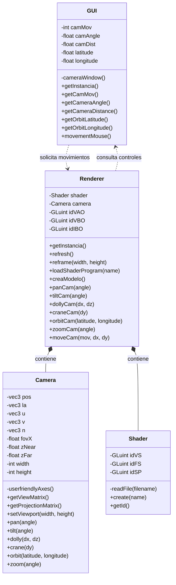

# pag-p3

1. PAG::Renderer. Nueva clase que encapsula todas las llamadas a OpenGL. Esto permite cambiar utilizar otra biblioteca en lugas de GLFW y no tener que cambiar nada en Renderer.
2. Dear ImGui añadido con una ventana de mensajes y un control de color de fondo
3. PAG::Gui. Nueva clase que encapsula la biblioteca ImGui
4. main.cpp solo gestiona eventos con GLFW y GLAD y las ventanas

Con esto conseguimos que en vez de mostrar el color de fondo directamente, y cambiarlo moviendo el raton,
ahora solo se cambia el color de fondo con una ventana de control.
Estos cambios (y los movimientos del raton) se muestran en una ventana de mensajes

Renderer dibuja la escena, pero GUI es la interfaz de usuario, por eso debe volver a dibujarse en cada iteración
y no solo cuando se debe refrescar la escena porque ha habido un movimiento de ratón.

**CAMBIOS REALIZADOS:**
1. Representación de un triángulo
    - Nuevos atributos (identificadores de los objetos OpenGL)
    - creaShaderProgram(); crea, compila y enlaza el shader program
    - creaModelo(); crea el VAO (contiene VBO e IBO), los VBO (3 vertices con su pos y color) y el IBO (orden vertices) del triángulo
    - el destructor libera todos los recursos

2. Comprobación de errores, lanzando una excepcion que se muestra en la ventana de mensajes
3. Ficheros aparte con los shaders del triángulo
    - con readFile()
4. Se le añade colores a los vértices del triángulo con un segundo atributo.
    - Implementado tanto de forma entrelazada como no entrelazada

**¿POR QUÉ SE DEFORMA EL TRIANGULO AL REDIMENSIONAR LA VENTANA?**
 
Cuando se crea una ventana, esta se inicializa en el espacio de coordenadas normalizadas(-1,-1) - (1,1).
El último paso de renderizar es 'mover' ese cuadrado a los pixeles que queramos con una formula -> 
x = w(x + 1)/2
y = h(y + 1)/2

Es decir, los vertices del triángulo se determinan en el espacio de coordenadas y el viewport 'recalcula' todas las coordenadas.
Se aplica la formula en los 3 vértices por lo que estos se 'mueven' con la pantalla.

Esto sucede en nuestro codigo ya que no aplicamos ninguna transformación para evitarlo.
Habría que aplicar una transformación de proyección, aplicando una matriz de proyección que incluta la relacion de aspecto (w/h)

# pag-p4
**CAMBIOS REALIZADOS:**
1. Desacoplamiento de shader programs. En la práctica anterior se realizaba en PAG::Renderer, ahora se encarga PAG::Shader
   - Se ha movido el método create de Renderer a Shader, con el cambio de que ahora se usan identificadores temporales.
   De esa forma el shader anterior solo se elimina cuando el sustituto ha compilado, evitando que la aplicación use un shader erróneo.
   - Sin embargo se ha definido un objeto shader en Renderer, para poder usarlo durante el renderizado, pero sin crearlo ni nada.
2. Nueva caja en la interfaz para añadir los shaders desde pantalla con un botón 'load'
   - Si se produce un error, se muestra en pantalla
3. El triángulo no se muestra de primeras, si no que aparece en pantalla al cargar un shader válido

Responsabilidad de cada clase (antes->ahora):
- Renderer: dibujaba la escena, gestionando los shader -> dibuja la escena y usa un objeto shader
- GUI: interfaz de usuario (pantalla de mensajes, color y triangulo) -> interfaz de usuario (pantalla de mensajes, color y carga de shader)
- Shader: no existía -> gestiona los shaders

# pag-p5
**SOPORTE PARA LA CÁMARA**
1. Nueva clase con los siguientes atributos:
- pos: posicion de la camara
- la: punto al que mira la camara
- u,v,n: ejes del sistema de coordenadas
- zNear y zFar: planos de recorte
- width, height: dimensiones del viewport

Además de un metodo para calcular los ejes locales de la camara, a partir de su posicion y el punto al que mira

2. Se obtienen las matrices de vision y proyección, que son pasadas al render para calcular MVP = P * V.
Con esta matriz:
- El vertex shader transforma las posiciones de los vértices
- El renderer redimensiona la ventana de la camara para mantener la relacion de aspecto

3. Movimientos de camara: Pan, Tilt, Dolly, Crane, Orbit, Zoom

4. Cambios en render:
- Objeto Camera
- Modificacion del metodo refresh para calcular MVP y enviarla al shader
- Metodo moveCam para poder usar los movimientos del raton para cambios de la camara
- Metodos para obtener todos los movimientos de la camara

5. Cambios en GUI:
- Nueva ventana para los movimientos de la camara
- Contiene un desplegable y distintos botones en funcion del movimiento que se seleccione

6. Callback para mover la camara con el ratón:
Se utilizan los valores obtenidos de la ventana de la camara para establecer la magnitud de movimiento.
El valor que se obtiene se divide en 100 pixeles para convertir el movimiento del raton en distancias.
Cuando se clicka el raton dentro de una de las otras ventanas, no se mueve la camara

**INSTRUCCIONES**
1. Introducir shader/pag03 en la ventana 'Shader Program' y pulsar Load.
2. Se muestra un triángulo en pantalla
3. Seleccionar un movimiento en el desplegable de la ventana 'Camara virtual'
4. Seleccionar un angulo o distancia
5. Mover la camara con los botones de la venta o con el botón izquierdo del ratón y desplazando
6. Usar la rueda del ratón o la ventana 'Color de fondo' para cambiar el color del fondo.

**DIAGRAMA DE CLASES UML**

## Diagrama de clases UML

